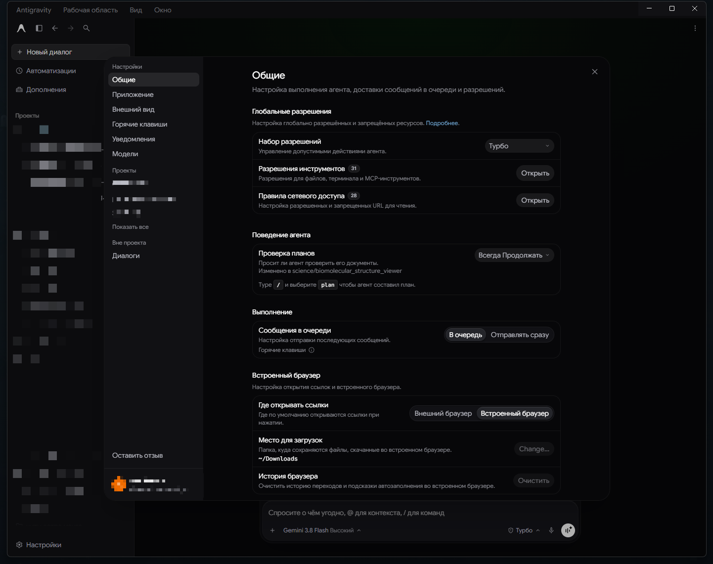
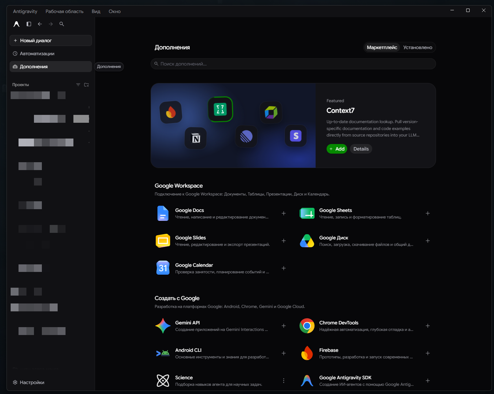

<div align="center">

# 🇷🇺 Русификатор Antigravity 2

**Полный перевод десктопного приложения Antigravity 2 (Windows и macOS Intel) на русский язык**  
Интерфейс, все разделы настроек, профили безопасности, системные меню и панель изменений — в одну команду.

[](https://github.com/SPIDIKSY/antigravity-ru)
[-0078D6?style=for-the-badge&logo=apple&logoColor=white)](https://github.com/SPIDIKSY/antigravity-ru)
[](https://github.com/SPIDIKSY/antigravity-ru)
[](https://github.com/SPIDIKSY/antigravity-ru/blob/main/LICENSE)

[](https://t.me/spididyanty)
[](https://dalink.to/spidiksy)

</div>

---

> [!TIP]
> **Нашли опечатку, баг или непереведённую кнопку?**  
> Кидайте скриншот или текст в наш Telegram-чат **[t.me/spididyanty](https://t.me/spididyanty)** — быстро поправим и добавим в обновление!

---

> [!IMPORTANT]
> **Поддерживаемые версии Antigravity:** `2.34.0`, `2.33.0`, `2.32.1`, `2.31.2`, `2.31.0`, `2.29.1`, `2.29.0`, `2.28.0`, `2.26.0`, `2.25.0`.
> Установщик автоматически определяет версию установленного Antigravity и выбирает подходящий набор файлов. В старых наборах доступен перевод возможностей того времени (например, цветные упоминания — начиная с 2.28.0).
> Если у вас другая версия — рекомендуется обновить Antigravity. Поставить набор 2.34.0 принудительно (на свой риск):
> - Windows (PowerShell): `& ([scriptblock]::Create((irm https://raw.githubusercontent.com/SPIDIKSY/antigravity-ru/main/install.ps1))) -Force`
> - macOS (Terminal): `curl -fsSL https://raw.githubusercontent.com/SPIDIKSY/antigravity-ru/main/install.sh | bash -s -- --force`

> [!NOTE]
> **Кастомные нововведения (сверх стандартного перевода):**
> - **Закрепление проектов (папок):** можно закрепить любой проект через меню проекта (`⋮` или правый клик) — он вынесется в отдельный сворачиваемый блок **«Закреплённые проекты»** над общим списком проектов (начиная с `2.32.1`).
> - **Цветные теги, команды и папки в чате:** при вставке в поле ввода через `@` или `/` (файлы, папки, диалоги, правила, слэш-команды и браузер), а также в меню «Добавить контекст» элементы подсвечиваются разными цветами по своему типу (начиная с `2.28.0`).
> - **Менеджер промптов и быстрый доступ:** отдельная вкладка **«Мои промпты»** в разделе «Дополнения» для создания, редактирования и постоянного хранения базы промптов (включая готовые шаблоны автономной работы) + кнопка быстрого выбора и вставки прямо в панели ввода чата (начиная с `2.33.0`).

---

## Быстрая установка (в 1 команду)

### Windows (PowerShell)

Откройте **PowerShell** и выполните одну строку:

```powershell
irm https://raw.githubusercontent.com/SPIDIKSY/antigravity-ru/main/install.ps1 | iex
```

### macOS (Intel / Терминал)

> Поддерживается **macOS на базе Intel (`x86_64`)**.

Откройте **Терминал** и выполните одну строку:

```bash
curl -fsSL https://raw.githubusercontent.com/SPIDIKSY/antigravity-ru/main/install.sh | bash
```

**Что сделает установщик за пару секунд:**
1. Найдёт установленный `Antigravity` (`Antigravity.exe` на Windows или `/Applications/Antigravity.app` на macOS).
2. Создаст резервную копию оригинальных файлов (`app.asar.original_backup` на Windows / `.antigravity_ru_backup` на macOS).
3. Скачает свежий языковой пакет с GitHub, применит русификацию (на macOS также обновит `ElectronAsarIntegrity` и переподпишет бандл `codesign`).

После завершения просто **перезапустите Antigravity**.

> [!NOTE]
> **Ваши данные в полной безопасности:** проекты, история диалогов, ключи API, MCP-серверы и авторизация аккаунта Google не затрагиваются.

---

## Скриншоты

<div align="center">

### Главное окно


<br><br>

### Настройки (Общие и Поведение агента)


<br><br>

### Дополнения и Маркетплейс


</div>

---

## Что переведено

| Раздел | Детали перевода |
| :--- | :--- |
| **Все вкладки настроек** | Общие, Приложение, Внешний вид, Модели, Настройки проекта, Браузер (более **1150 фраз**). |
| **Диалог и агент** | Меню ⋮ диалога, панель обзора, вопросы агента, сводка шагов, время работы, план агента. |
| **Цветные упоминания** | Упоминания в поле ввода и пункты «Добавить контекст» окрашены по типу: файлы, диалоги, правила, команды, браузер. |
| **Дополнения (Плагины)** | Разделы «Маркетплейс», «Установлено» и менеджер «Мои промпты», описания всех 65+ плагинов и дополнений, кнопки («Рекомендуемое», «Добавить», «Подробнее»), поиск и фильтры. |
| **Закрепление проектов** | Закрепление папок (проектов) в отдельном блоке «Закреплённые проекты» над «Проекты» через меню проекта (`⋮` и правый клик). |
| **Слэш-команды и меню** | Описания команд (`/goal`, `/plan`, `/schedule` и др.), меню проекта, добавление контекста, режимы разрешений. |
| **Безопасность и доступы** | Профили поведения агента, права на чтение и запись файлов, сетевой доступ, терминал и MCP. |
| **Расход токенов** | Статистика контекста на правила (`Rules`), навыки (`Skills`) и MCP-серверы с выпадающими списками. |
| **Контроль версий (Git)** | Незафиксированные файлы, изменения агента, переключение веток и статусы репозитория. |
| **Поиск и навигация** | Переведены все подсказки, фильтры и плейсхолдеры в строках поиска. |
| **Системные меню Windows и macOS** | Верхнее меню (`Файл`, `Правка`, `Вид`, `Окно`, `Справка`, меню приложения macOS), меню в трее / Dock, экран запуска и диалоги выхода. |
| **Защита от слёта** | Фоновое автообновление отключено, чтобы русификатор не сбрасывался сам по себе во время работы. |

---

## Управление и откат

### Как вернуть английский язык (Откат к оригиналу)

**Windows (PowerShell):**
```powershell
& ([scriptblock]::Create((irm https://raw.githubusercontent.com/SPIDIKSY/antigravity-ru/main/install.ps1))) -Uninstall
```

**macOS (Терминал):**
```bash
curl -fsSL https://raw.githubusercontent.com/SPIDIKSY/antigravity-ru/main/install.sh | bash -s -- --uninstall
```
Оригинальный `app.asar` (и оригинальная цифровая подпись Google на macOS) мгновенно восстановятся из резервной копии.

### Что делать, когда выйдет новая версия Antigravity

1. Обновите Antigravity вручную через меню приложения: фоновое автообновление при установленном русификаторе отключено.
2. Снова выполните команду установки для вашей ОС:
   - **Windows (PowerShell):**
     ```powershell
     irm https://raw.githubusercontent.com/SPIDIKSY/antigravity-ru/main/install.ps1 | iex
     ```
   - **macOS (Терминал):**
     ```bash
     curl -fsSL https://raw.githubusercontent.com/SPIDIKSY/antigravity-ru/main/install.sh | bash
     ```

<details>
<summary><b>Установка вручную через Git (для разработчиков)</b></summary>
<br>

Если вы хотите склонировать репозиторий локально и запускать установщик вручную. Поддерживаются **Windows PowerShell 5.1** (`powershell`), **PowerShell 7** (`pwsh`) и **macOS** (`bash` / `zsh`):

```bash
git clone https://github.com/SPIDIKSY/antigravity-ru.git
cd antigravity-ru

# --- Windows (PowerShell) ---
# Обычная установка
powershell -ExecutionPolicy Bypass -Command "& ([scriptblock]::Create((Get-Content install.ps1 -Raw -Encoding UTF8))) -Install"

# Установка без принудительного закрытия запущенных окон Antigravity
powershell -ExecutionPolicy Bypass -Command "& ([scriptblock]::Create((Get-Content install.ps1 -Raw -Encoding UTF8))) -Install -NoKill"

# Удаление русификации
powershell -ExecutionPolicy Bypass -Command "& ([scriptblock]::Create((Get-Content install.ps1 -Raw -Encoding UTF8))) -Uninstall"

# --- macOS (Терминал) ---
# Интерактивное меню (установка / удаление)
./install.sh

# Обычная установка
./install.sh --install

# Установка без принудительного закрытия запущенных окон Antigravity
./install.sh --install --no-kill

# Удаление русификации
./install.sh --uninstall
```
</details>

<details>
<summary><b>Открытый исходный код: какие файлы ядра меняет патчер</b></summary>
<br>

В репозитории нет закрытых бинарников: установщик копирует готовые файлы из `resources\<версия>\`, а `app.asar` — обычный архив, который можно распаковать и проверить. Какие строки меняются, показывает скрипт `patch.js` (установщик его не запускает, последний раз он обновлялся для версии 2.26.0):

| Файл ядра | Что именно меняет русификатор |
| :--- | :--- |
| `dist/languageServer.js` | Подключает языковой бандл с русским переводом интерфейса |
| `dist/menu.js` | Переводит верхнее системное меню окна |
| `dist/tray.js` | Переводит контекстное меню в трее и счётчик активных агентов |
| `dist/main.js` | Переводит диалоги подтверждения выхода |
| `dist/updater.js` | Отключает принудительные фоновые автообновления |
| `dist/loadingOverlay.js` | Переводит экран запуска («Загрузка Antigravity...») |
| `dist/ideInstall/wizardHtml.js` | Переводит мастер первоначальной настройки |

Кроме `app.asar`, в папку `web_bundle_ru` кладётся копия веб-интерфейса с тремя изменениями: подключён `i18n-ru.js` (словарь перевода), в `index.html` добавлены стили (цвета упоминаний), в `main.js` — правильные окончания в «N вопросов» и метки типа у упоминаний для этих цветов.

</details>

---

## Часто задаваемые вопросы (FAQ)

<details open>
<summary><b>Как поставить русский язык в Antigravity?</b></summary>
<ul>
  <li><b>Windows:</b> откройте PowerShell и выполните <code>irm https://raw.githubusercontent.com/SPIDIKSY/antigravity-ru/main/install.ps1 | iex</code></li>
  <li><b>macOS:</b> откройте Терминал и выполните <code>curl -fsSL https://raw.githubusercontent.com/SPIDIKSY/antigravity-ru/main/install.sh | bash</code></li>
</ul>
</details>

<br>

<details open>
<summary><b>Слетят ли мои проекты, чаты или аккаунт после установки?</b></summary>
<b>Нет.</b> Русификатор меняет только текст интерфейса и не трогает пользовательскую папку с настройками, историей и сессиями.
</details>

<br>

<details open>
<summary><b>Помогает ли русификатор обойти региональные ограничения?</b></summary>
<b>Нет.</b> Это исключительно перевод интерфейса программы. Для работы с моделями в неподдерживаемых регионах по-прежнему необходим рабочий прокси или VPN.
</details>

---

## Поддержать проект

<div align="center">

Если русификатор и дополнительные фичи оказались полезными, можно поддержать развитие проекта и будущие обновления под новые версии Antigravity:

[**Перейти к поддержке на daLink**](https://dalink.to/spidiksy)

<br>

<a href="https://dalink.to/spidiksy">
  
</a>

</div>
