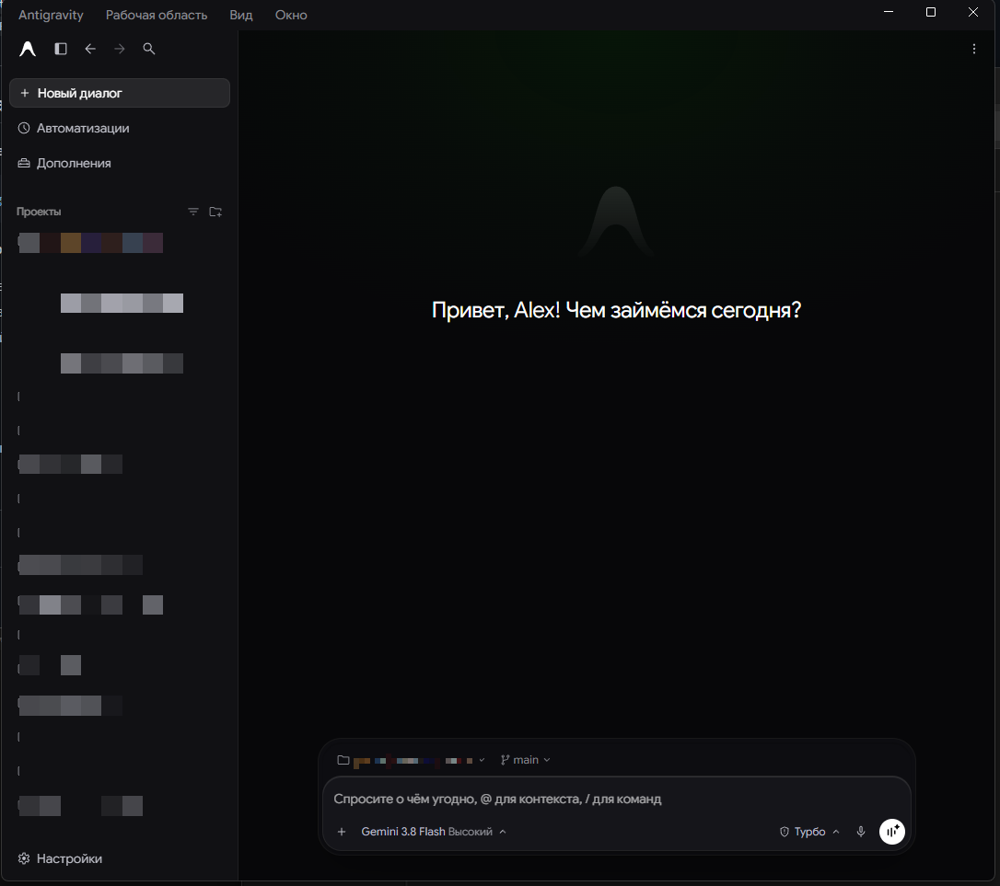

<div align="center">

# 🇷🇺 Русификатор Antigravity 2

**Полный перевод Antigravity 2 для Windows и macOS (Intel) в одну команду.**

[](https://github.com/SPIDIKSY/antigravity-ru)
[](https://github.com/SPIDIKSY/antigravity-ru)
[](https://github.com/SPIDIKSY/antigravity-ru/blob/main/LICENSE)

[](https://t.me/spididyanty)
[](https://dalink.to/spidiksy)

</div>

---

<details>
<summary><b>Поддерживаемые версии и принудительная установка</b></summary>
<br>

Поддерживаются версии: `2.34.0`, `2.33.0`, `2.32.1`, `2.31.2`, `2.31.0`, `2.29.1`, `2.29.0`, `2.28.0`, `2.26.0`, `2.25.0`.  
Установщик сам определяет установленную версию. Если у вас другая версия — поставьте набор `2.34.0` принудительно (на свой риск):

- **Windows (PowerShell):**
  ```powershell
  & ([scriptblock]::Create((irm https://raw.githubusercontent.com/SPIDIKSY/antigravity-ru/main/install.ps1))) -Force
  ```
- **macOS Intel (Терминал):**
  ```bash
  curl -fsSL https://raw.githubusercontent.com/SPIDIKSY/antigravity-ru/main/install.sh | bash -s -- --force
  ```

</details>

<details>
<summary><b>Дополнительные функции (сверх перевода)</b></summary>
<br>

- **Закрепление проектов** — вынос нужных папок в отдельный блок «Закреплённые проекты» через меню `⋮` или ПКМ (с `2.32.1`).
- **Цветные упоминания** — подсветка тегов `@` и `/` в чате и меню «Добавить контекст» по типу (с `2.28.0`).
- **Мои промпты** — встроенный менеджер промптов во вкладке «Дополнения» и быстрая вставка из панели чата (с `2.33.0`).

</details>

<details>
<summary><b>Нашли ошибку или непереведённую строку?</b></summary>
<br>

Присылайте скриншот или текст в Telegram-чат **[t.me/spididyanty](https://t.me/spididyanty)**.

</details>

---

## Быстрая установка

### Windows (PowerShell)

```powershell
irm https://raw.githubusercontent.com/SPIDIKSY/antigravity-ru/main/install.ps1 | iex
```

### macOS Intel (`x86_64`, Терминал)

```bash
curl -fsSL https://raw.githubusercontent.com/SPIDIKSY/antigravity-ru/main/install.sh | bash
```

Установщик автоматически создаст резервную копию оригинальных файлов и применит перевод, после чего перезапустите Antigravity. Проекты, чаты, ключи API и аккаунт Google не затрагиваются.

---

## Скриншоты

<div align="center">

### Главное окно


<br><br>

### Настройки


<br><br>

### Дополнения и Маркетплейс


</div>

---

## Что переведено

| Раздел | Детали |
| :--- | :--- |
| **Настройки** | Общие, Приложение, Внешний вид, Модели, Настройки проекта, Браузер. |
| **Диалог и агент** | Меню диалога, обзор, вопросы агента, сводка шагов, время работы, план агента. |
| **Дополнения и команды** | Маркетплейс, описания плагинов, фильтры, слэш-команды, меню проекта и контекст. |
| **Безопасность и Git** | Профили поведения, права доступа, MCP, расход токенов, ветки и изменения Git. |
| **Системные меню** | Верхнее меню окна, трей / Dock, экран запуска, диалоги выхода и отключение фонового автообновления. |

---

## Откат и обновление

### Вернуть английский язык

**Windows (PowerShell):**
```powershell
& ([scriptblock]::Create((irm https://raw.githubusercontent.com/SPIDIKSY/antigravity-ru/main/install.ps1))) -Uninstall
```

**macOS Intel (Терминал):**
```bash
curl -fsSL https://raw.githubusercontent.com/SPIDIKSY/antigravity-ru/main/install.sh | bash -s -- --uninstall
```

### После обновления Antigravity

Фоновое автообновление при установленном русификаторе отключено. После ручного обновления приложения просто повторно запустите команду быстрой установки.

<details>
<summary><b>Ручная установка через Git и структура патчей</b></summary>
<br>

```bash
git clone https://github.com/SPIDIKSY/antigravity-ru.git
cd antigravity-ru

# Windows (PowerShell)
powershell -ExecutionPolicy Bypass -Command "& ([scriptblock]::Create((Get-Content install.ps1 -Raw -Encoding UTF8))) -Install"
powershell -ExecutionPolicy Bypass -Command "& ([scriptblock]::Create((Get-Content install.ps1 -Raw -Encoding UTF8))) -Install -NoKill"
powershell -ExecutionPolicy Bypass -Command "& ([scriptblock]::Create((Get-Content install.ps1 -Raw -Encoding UTF8))) -Uninstall"

# macOS Intel (Терминал)
./install.sh                    # интерактивное меню
./install.sh --install          # установка
./install.sh --install --no-kill # без закрытия Antigravity
./install.sh --uninstall        # откат
```

Список изменяемых файлов ядра отражён в `patch.js`: `dist/languageServer.js`, `dist/menu.js`, `dist/tray.js`, `dist/main.js`, `dist/updater.js`, `dist/loadingOverlay.js`, `dist/ideInstall/wizardHtml.js`, а также `web_bundle_ru` (`i18n-ru.js`, `index.html`, `main.js`).

</details>

<details>
<summary><b>Частые вопросы (FAQ)</b></summary>
<br>

- **Слетят ли проекты, чаты или аккаунт?** Нет, пользовательские данные, история и сессии не затрагиваются.
- **Помогает ли русификатор обойти региональные ограничения?** Нет, это только перевод интерфейса.

</details>

---

## Поддержать проект

<div align="center">

[**Перейти к поддержке на daLink**](https://dalink.to/spidiksy)

<br>

<a href="https://dalink.to/spidiksy">
  
</a>

</div>
