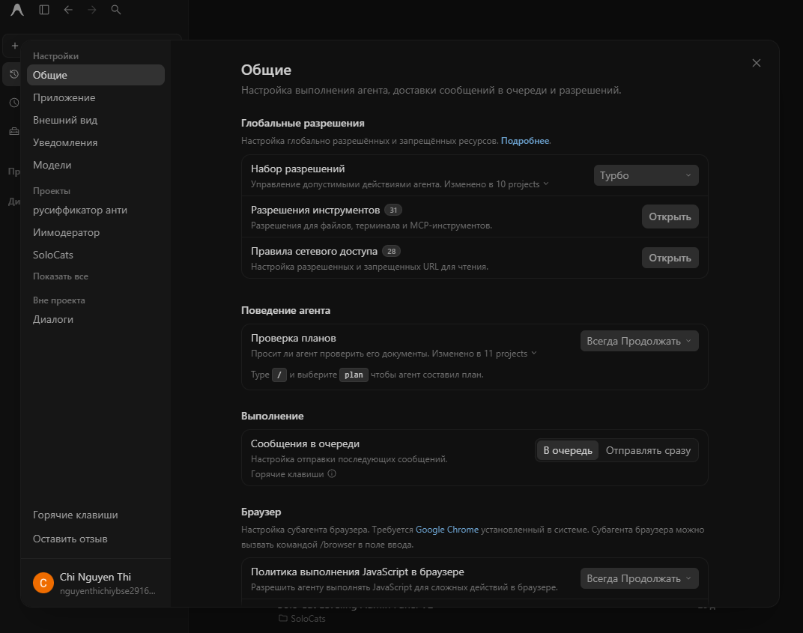
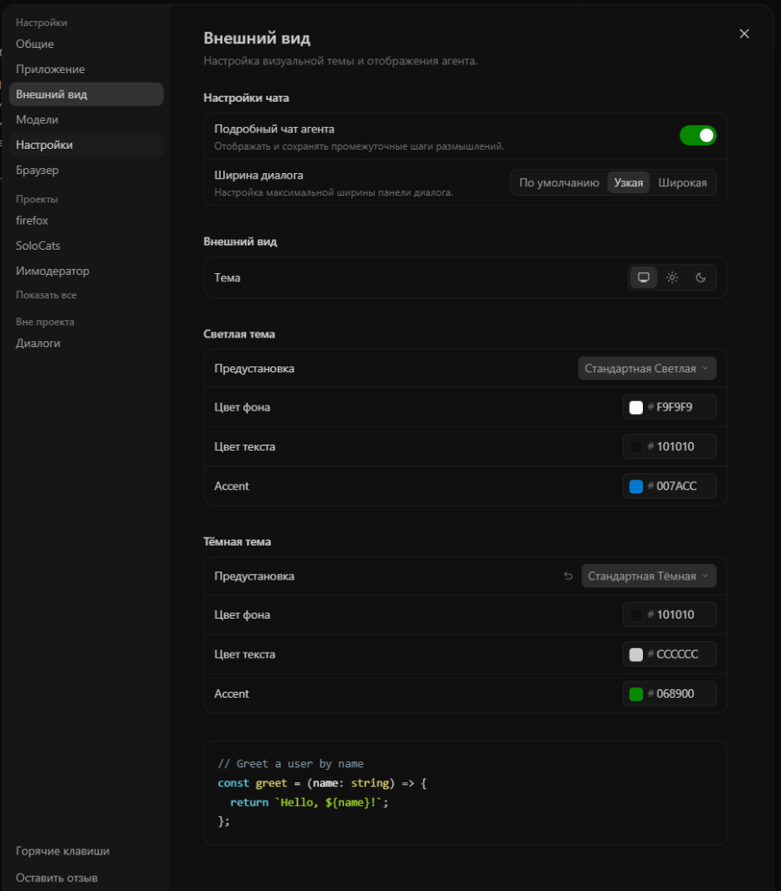
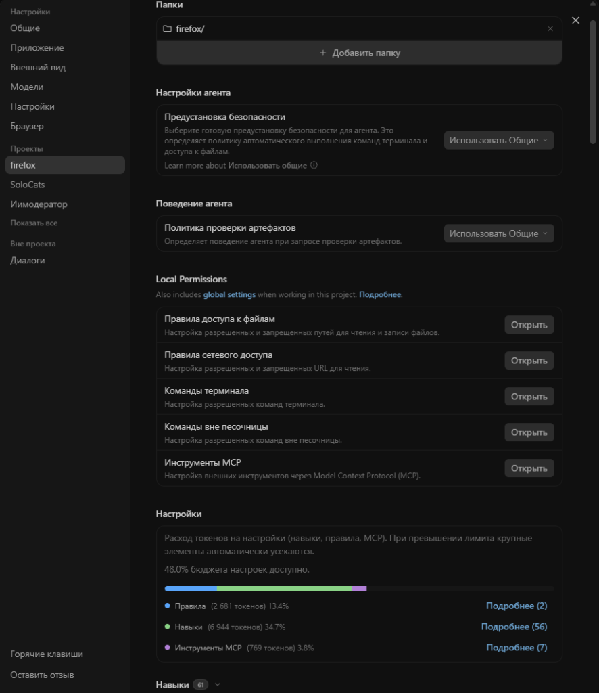

<div align="center">

# 🇷🇺 Русификатор Antigravity 2

**Полный перевод десктопного приложения Antigravity 2 (Windows) на русский язык**  
Интерфейс, все разделы настроек, профили безопасности, системные меню и панель изменений — в одну команду.

[](https://github.com/SPIDIKSY/antigravity-ru)
[](https://github.com/SPIDIKSY/antigravity-ru)
[](https://github.com/SPIDIKSY/antigravity-ru)
[](https://github.com/SPIDIKSY/antigravity-ru/blob/main/LICENSE)

[](https://t.me/spididyanty)

[**Быстрая установка**](#-быстрая-установка-в-1-команду) • [**Скриншоты**](#-скриншоты) • [**Что переведено**](#-что-переведено) • [**Обновление и откат**](#-управление-и-откат) • [**FAQ**](#-часто-задаваемые-вопросы-faq) • [**Telegram**](https://t.me/spididyanty)

</div>

---

> [!TIP]
> **Нашли опечатку, баг или непереведённую кнопку?**  
> Кидайте скриншот или текст в наш Telegram-чат **[t.me/spididyanty](https://t.me/spididyanty)** — быстро поправим и добавим в обновление!

---

## Быстрая установка (в 1 команду)

Откройте **PowerShell** и выполните одну строку:

```powershell
irm https://raw.githubusercontent.com/SPIDIKSY/antigravity-ru/main/install.ps1 | iex
```

**Что сделает установщик за пару секунд:**
1. Найдёт установленный `Antigravity` на вашем ПК.
2. Создаст резервную копию оригинального файла `app.asar.bak`.
3. Скачает свежий языковой пакет с GitHub и применит русификацию.

После завершения просто **перезапустите Antigravity**.

> [!NOTE]
> **Ваши данные в полной безопасности:** проекты, история диалогов, ключи API, MCP-серверы и авторизация аккаунта Google не затрагиваются.

---

## Скриншоты

<div align="center">

### Настройки (Общие и Поведение агента)


<br><br>

### Настройки (Внешний вид и Интерфейс)


<br><br>

### Настройки проекта и Расход токенов


</div>

---

## Что переведено

| Раздел | Детали перевода |
| :--- | :--- |
| **Все вкладки настроек** | Общие, Приложение, Внешний вид, Модели, Настройки проекта, Браузер (более **990 фраз**). |
| **Безопасность и доступы** | Профили поведения агента, права на чтение и запись файлов, сетевой доступ, терминал и MCP. |
| **Расход токенов** | Статистика контекста на правила (`Rules`), навыки (`Skills`) и MCP-серверы с выпадающими списками. |
| **Контроль версий (Git)** | Незафиксированные файлы, изменения агента, переключение веток и статусы репозитория. |
| **Поиск и навигация** | Переведены все подсказки, фильтры и плейсхолдеры в строках поиска. |
| **Системные меню Windows** | Верхнее меню (`Файл`, `Правка`, `Вид`, `Окно`, `Справка`), иконка в трее, экран запуска и диалоги выхода. |
| **Защита от слёта** | Фоновое автообновление отключено, чтобы русификатор не сбрасывался сам по себе во время работы. |

---

## Управление и откат

### Как вернуть английский язык (Откат к оригиналу)

Запустите команду установки повторно и выберите пункт **`[2] Удалить русификацию`**, либо выполните напрямую:

```powershell
powershell -ExecutionPolicy Bypass -File install.ps1 -Uninstall
```
Оригинальный `app.asar` мгновенно восстановится из резервной копии.

### Что делать, когда выйдет новая версия Antigravity

1. Разрешите приложению штатно обновиться.
2. Снова выполните команду в PowerShell:
   ```powershell
   irm https://raw.githubusercontent.com/SPIDIKSY/antigravity-ru/main/install.ps1 | iex
   ```

<details>
<summary><b>Установка вручную через Git (для разработчиков)</b></summary>
<br>

Если вы хотите склонировать репозиторий локально и запускать патчер вручную:

```bash
git clone https://github.com/SPIDIKSY/antigravity-ru.git
cd antigravity-ru

# Обычная установка
powershell -ExecutionPolicy Bypass -File install.ps1 -Install

# Установка без принудительного закрытия запущенных окон Antigravity
powershell -ExecutionPolicy Bypass -File install.ps1 -Install -NoKill
```
</details>

<details>
<summary><b>Открытый исходный код: какие файлы ядра меняет патчер</b></summary>
<br>

В репозитории нет закрытых бинарников. Скрипт `patch.js` открыто модифицирует только текстовые строки в бандле:

| Файл ядра | Что именно меняет русификатор |
| :--- | :--- |
| `dist/languageServer.js` | Подключает языковой бандл с русским переводом интерфейса |
| `dist/menu.js` | Переводит верхнее системное меню окна |
| `dist/tray.js` | Переводит контекстное меню в трее и счётчик активных агентов |
| `dist/main.js` | Переводит диалоги подтверждения выхода |
| `dist/updater.js` | Отключает принудительные фоновые автообновления |
| `dist/loadingOverlay.js` | Переводит экран запуска («Загрузка Antigravity...») |
| `dist/ideInstall/wizardHtml.js` | Переводит мастер первоначальной настройки |

</details>

---

## Часто задаваемые вопросы (FAQ)

<details open>
<summary><b>Как поставить русский язык в Antigravity?</b></summary>
Откройте PowerShell и выполните: <code>irm https://raw.githubusercontent.com/SPIDIKSY/antigravity-ru/main/install.ps1 | iex</code>.
</details>

<br>

<details open>
<summary><b>Слетят ли мои проекты, чаты или аккаунт после установки?</b></summary>
<b>Нет.</b> Русификатор меняет только текст интерфейса и не трогает пользовательскую папку с настройками, историей и сессиями.
</details>

<br>

<details open>
<summary><b>Помогает ли русификатор обойти региональные ограничения?</b></summary>
<b>Нет.</b> Это исключительно перевод интерфейса программы. Для работы с моделями в неподдерживаемых регионах по-прежнему необходим рабочий прокси или VPN.
</details>

---

## Сообщество и баг-репорты

Проект активно развивается! Если вы заметили непереведённую фразу после обновления, кривой перенос текста или ошибку:

<div align="center">

[](https://t.me/spididyanty)

**Прямая ссылка:** [https://t.me/spididyanty](https://t.me/spididyanty)

</div>

---

<div align="center">

**MIT License** • Свободный открытый проект для русскоязычного сообщества разработчиков  
Если русификатор оказался полезен — поставьте звезду репозиторию на GitHub!

</div>
